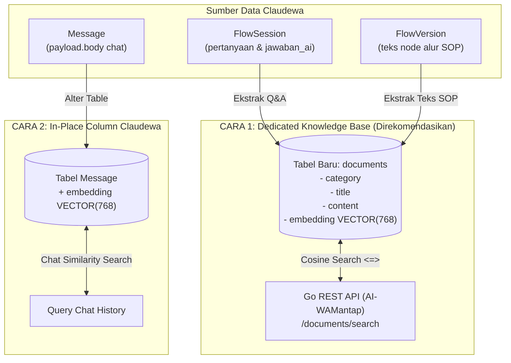

# Panduan Arsitektur & Sinkronisasi Vektor: Claudewa WhatsApp x pgvector Gemini

Dokumen ini menjelaskan dan membandingkan dua pendekatan implementasi **Pencarian Semantik (pgvector)** dan **AI Assistant (RAG - Retrieval-Augmented Generation)** untuk layanan WhatsApp Pemerintah Kota Cimahi (**WA Mantap**) berbasis database **Claudewa**.

---

## 📌 Ringkasan Eksekutif

Dalam database Claudewa ([claudewa-lengkap.sql](file:///c:/Tugas%20Kuliah/intership%201/AI-WAMantap/claudewa-lengkap.sql) / [claudewa_data.json](file:///c:/Tugas%20Kuliah/intership%201/AI-WAMantap/claudewa_data.json)), terdapat **16 tabel relasional**. Sebagian besar tabel (`Organization`, `User`, `Channel`, `Contact`, `Campaign`, `Conversation`, `WebhookEvent`, dll) merupakan tabel operasional transaksional yang **tidak membutuhkan vector embedding**.

Kebutuhan AI semantik hanya memerlukan teks **SOP, Panduan Layanan Publik, dan FAQ Tanya-Jawab**. Untuk menyematkan vektor (vektor 768 dimensi dari Google Gemini `gemini-embedding-001`), terdapat dua pendekatan arsitektur yang dapat dipilih:

1. **CARA 1 (Best Practice)**: Membuat tabel terpisah khusus Knowledge Base bernama `documents`.
2. **CARA 2 (In-Place)**: Menambahkan kolom `embedding` langsung ke tabel bawaan Claudewa, yaitu tabel `Message`.

---

## 🏗️ Diagram Arsitektur Komparasi



---

## 🌟 CARA 1 (Paling Direkomendasikan & Best Practice)
### *Membuat Tabel Khusus `documents` sebagai Knowledge Base RAG*

Pendekatan ini memisahkan secara tegas antara **Database Operasional WhatsApp** dan **Database Pengetahuan Semantik AI (Knowledge Base)**.

### 1. Skema Database
```sql
-- Aktifkan ekstensi pgvector
CREATE EXTENSION IF NOT EXISTS vector;

-- Tabel khusus Knowledge Base / SOP Dokumen
CREATE TABLE IF NOT EXISTS documents (
    id SERIAL PRIMARY KEY,
    category VARCHAR(100) NOT NULL DEFAULT 'Umum',
    title VARCHAR(255) NOT NULL,
    content TEXT NOT NULL,
    embedding VECTOR(768) NOT NULL,
    created_at TIMESTAMP DEFAULT CURRENT_TIMESTAMP
);

-- Index HNSW untuk pencarian cosine distance berkecepatan tinggi
CREATE INDEX IF NOT EXISTS documents_embedding_idx 
ON documents USING hnsw (embedding vector_cosine_ops);
```

### 2. Sumber Data yang Di-embed
AI mengekstrak dan memformat teks yang bermakna informasi layanan:
- **Dari [FlowSession.json](file:///c:/Tugas%20Kuliah/intership%201/AI-WAMantap/seeds/FlowSession.json)**:
  - `variables.pertanyaan` ➡️ Masuk ke kolom `title` (misal: *"KTP hilang"*).
  - `variables.jawaban_ai` ➡️ Masuk ke kolom `content` (prosedur surat kehilangan polsek, syarat KK, ke kantor kecamatan).
  - `category` ➡️ `Kependudukan`.
- **Dari [FlowVersion.json](file:///c:/Tugas%20Kuliah/intership%201/AI-WAMantap/seeds/FlowVersion.json)**:
  - Teks node resmi: SOP Kedaruratan 112, Makan Bergizi Gratis (MBG) & SPPG Kelurahan Cibeber, SP4N LAPOR, Kartu Kuning Sidakeptri, antrean Mal Pelayanan Publik (MPP).
- **Dari [dummy_data.json](file:///c:/Tugas%20Kuliah/intership%201/AI-WAMantap/dummy_data.json)**:
  - 100 SOP data kependudukan dan perizinan kota.

### 3. Kelebihan CARA 1:
- ✅ **Skema Asli Claudewa Aman**: Tidak ada perubahan DDL pada tabel bawaan Claudewa, sehingga aman saat ada pembaruan versi atau migrasi Prisma di masa depan.
- ✅ **100% Kompatibel dengan Backend Go**: Repository ini ([AI-WAMantap](file:///c:/Tugas%20Kuliah/intership%201/AI-WAMantap)) sudah memiliki handler controller lengkap (`/documents`, `/documents/search`, `/documents/seed`) yang siap pakai untuk tabel `documents`.
- ✅ **Performa Vektor Optimal & Ringan**: Tabel `documents` hanya berisi ratusan baris SOP/FAQ pilihan, sehingga index HNSW sangat cepat (sub-millisecond) dan hemat memori RAM PostgreSQL.
- ✅ **Manajemen Pengetahuan Mudah**: Jika ada perubahan regulasi/SOP baru dari dinas, admin cukup melakukan `POST /documents` atau `PUT /documents/{id}` tanpa menyentuh alur bot WhatsApp.

### 4. Kekurangan CARA 1:
- ⚠️ Memerlukan tabel tambahan (`documents`) di database.
- ⚠️ Membutuhkan script sinkronisasi satu kali untuk mengekstrak teks dari `FlowSession` & `FlowVersion` ke format dokumen.

---

## 🛠️ CARA 2 (Alternatif: Menempelkan Langsung di Skema Claudewa)
### *Menambahkan Kolom Vektor Langsung ke Tabel `Message`*

Jika ingin struktur tabel tetap berada di dalam entitas database Claudewa tanpa membuat tabel baru, maka **satu-satunya tabel yang relevan** adalah tabel `Message`.

### 1. Skema Database
```sql
-- Aktifkan ekstensi pgvector
CREATE EXTENSION IF NOT EXISTS vector;

-- Tambahkan kolom vektor ke tabel Message bawaan Claudewa
ALTER TABLE "Message" ADD COLUMN "embedding" VECTOR(768);

-- Index HNSW untuk pencarian pesan
CREATE INDEX IF NOT EXISTS message_embedding_idx 
ON "Message" USING hnsw (embedding vector_cosine_ops);
```

### 2. Sumber Data yang Di-embed
- Kolom `payload->>'body'` pada tabel `Message` (teks chat masuk dan keluar).
- Setiap ada pesan chat baru, sistem menghitung vektor dari isi pesan tersebut.

### 3. Fungsi Utama CARA 2:
- **Pencarian Riwayat Chat (Chat History Search)**: Mencari pesan-pesan sebelumnya dari percakapan warga yang konteksnya mirip.
- **Deteksi FAQ Berulang**: Memeriksa apakah pesan yang baru masuk mirip dengan pesan yang pernah ditanyakan sebelumnya.

### 4. Kelebihan CARA 2:
- ✅ Tidak perlu membuat tabel baru di luar skema Claudewa.
- ✅ Semua histori chat WhatsApp langsung memiliki representasi vektor numerik.

### 5. Kekurangan & Risiko CARA 2:
- ❌ **Tabel `Message` Sangat Cepat Membengkak**: Tabel pesan adalah tabel paling sibuk. Menyimpan vektor 768 dimensi (±3 KB per baris) pada ratusan ribu pesan chat akan memboroskan penyimpanan dan memperlambat index PostgreSQL.
- ❌ **Biaya Token API Membengkak**: Setiap chat (termasuk chat sapaan seperti *"Halo"*, *"P"*, *"Terima kasih"*, *"OK"*) akan sia-sia jika di-embed ke Gemini API.
- ❌ **Kualitas Jawaban Rendah (Noise Tinggi)**: Chat mentah warga seringkali tidak lengkap, typo, atau terpotong-potong, sehingga pencarian vektor di tabel `Message` menghasilkan informasi yang kurang terstruktur dibanding SOP resmi.
- ❌ **Merusak Standar Prisma Claudewa**: Migrasi skema Prisma Claudewa sewaktu-waktu bisa menimpa kolom `embedding` jika skema Prisma tidak disinkronkan secara manual.

---

## ⚖️ Tabel Perbandingan Head-to-Head

| Kriteria Evaluasi | CARA 1: Tabel Khusus `documents` (Rekomendasi) | CARA 2: Kolom Vektor di `Message` |
| :--- | :--- | :--- |
| **Tujuan Utama** | **Knowledge Base RAG (Solusi SOP & FAQ Akurat)** | **Pencarian Kesamaan Riwayat Pesan (Chat History)** |
| **Kerapian Arsitektur** | ⭐⭐⭐⭐⭐ Bersih & *Decoupled* | ⭐⭐ Tercampur antara transaksi & AI |
| **Kualitas Jawaban AI** | ⭐⭐⭐⭐⭐ Sangat Tinggi (SOP terstruktur) | ⭐⭐⭐ Sedang (Chat warga banyak yang tidak baku) |
| **Dampak Performa DB** | ⭐⭐⭐⭐⭐ Ringan (Hanya berisi dokumen SOP) | ⭐⭐ Berat (Index HNSW membebani tabel chat jutaan baris) |
| **Biaya API Gemini** | ⭐⭐⭐⭐⭐ Sangat Hemat (Hanya embed SOP terpilih) | ⭐ Boros (Bisa memanggil API untuk setiap pesan chat biasa) |
| **Kesiapan dengan Kode Repo** | ⭐⭐⭐⭐⭐ **100% Siap Pakai** (Controller & Router Go sudah ada) | ⭐ Perlu merombak ulang controller & query SQL Go |
| **Kompatibilitas Claudewa** | ⭐⭐⭐⭐⭐ Tidak mengganggu skema Prisma bawaan | ⚠️ Rawan tertimpa saat migrasi Prisma berjalan |

---

## 🚀 Rekomendasi & Rencana Tindak Lanjut

Berdasarkan perbandingan di atas, **CARA 1 adalah pilihan mutlak terbaik**:

1. **Jalankan Database Claudewa**:
   - Seed data operasional dari folder [seeds/](file:///c:/Tugas%20Kuliah/intership%201/AI-WAMantap/seeds/) ke database Claudewa PostgreSQL.
2. **Siapkan Tabel `documents`**:
   - Eksekusi pembuatan tabel `documents` dan index HNSW di database.
3. **Ekstrak & Seed Knowledge Base**:
   - Ekstrak Q&A dari `FlowSession` (`variables.pertanyaan` + `variables.jawaban_ai`) dan teks alur dari `FlowVersion`.
   - Masukkan ke tabel `documents` melalui endpoint:
     ```http
     POST http://localhost:8080/documents
     ```
4. **Hubungkan Claudewa ke Go API**:
   - Konfigurasi pada tabel `AiEndpoint` di Claudewa mengarahkan pencarian semantik ke:
     ```
     POST /documents/search?q={{pertanyaan}}
     ```
   - Claudewa otomatis mengirim pertanyaan warga, Go melakukan pencarian semantik pgvector di tabel `documents`, dan Gemini membalas WhatsApp dengan jawaban SOP resmi yang akurat.
