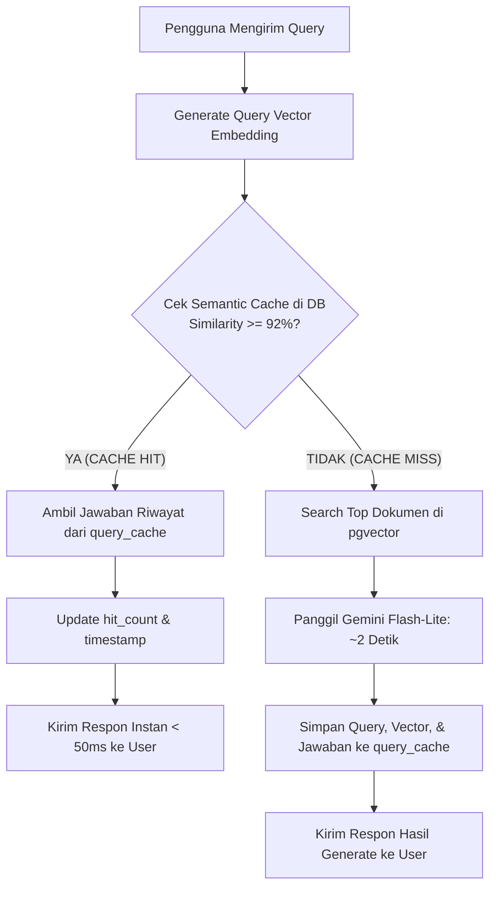

# 🚀 Dokumentasi Pembaruan Sistem (Update Log)

Dokumen ini mencatat pembaruan performa arsitektur dan penambahan fitur **Semantic Caching** pada sistem **Go + pgvector + Gemini**, yang berhasil memangkas waktu tunggu respon AI secara drastis serta mengoptimalkan efisiensi query.

---

## 📌 Ringkasan Pembaruan Utama

| Komponen | Sebelum Pembaruan | Setelah Pembaruan | Peningkatan / Benefit |
| :--- | :--- | :--- | :--- |
| **Model LLM Feedback** | Model berukuran berat / standar | `gemini-2.5-flash-lite` / `gemini-flash-lite-latest` | **Latensi turun dari ~13 detik ➡️ ~2 detik** |
| **Sistem Caching** | Tidak ada (Setiap query selalu memanggil LLM ulang) | **Semantic Query Cache** berbasis vector di PostgreSQL | **Response time cache hit: < 50 milidetik** |
| **Threshold Kemiripan Cache** | - | **≥ 92% (0.92 cosine similarity)** | Mencegah jawaban meleset sambil mendeteksi makna serupa |
| **Efisiensi Token & Kuota** | Kuota API Gemini terus terpakai untuk pertanyaan serupa | Hemat kuota API hingga 100% pada pertanyaan berulang | Mengurangi beban komputasi dan biaya API |

---

## ⚡ 1. Optimasi Model AI Feedback: 13 Detik ➡️ 2 Detik

### Masalah Sebelumnya
Sebelum pembaruan, fungsi pembuatan tanggapan (*generative feedback*) menggunakan model yang membutuhkan waktu inferensi panjang (mencapai rata-rata **13 detik**). Untuk interaksi pengguna (*chat/customer service*), waktu tunggu 13 detik terasa lambat dan kurang responsif.

### Solusi & Penerapan
Pembaruan diterapkan pada file [`embedding/gemini.go`](file:///c:/Tugas%20Kuliah/intership%201/go-pgvector-gemini/embedding/gemini.go):
1. **Migrasi ke Flash-Lite Series**: Menggunakan model `gemini-2.5-flash-lite` dengan fallback teruji yang dirancang khusus untuk respon berkecepatan tinggi (*sub-second inference*).
2. **Pembatasan Output Token yang Terukur**: Mengatur `MaxOutputTokens: 400` pada konfigurasi generasi JSON, cukup padat untuk merangkum solusi tanpa membuang waktu streaming token yang berlebihan.
3. **Structured JSON Output**: Memanfaatkan `ResponseMIMEType: "application/json"` bawaan Gemini API sehingga respon langsung berupa JSON terstruktur tanpa perlu manipulasi regex atau format lambat.

```go
// Cuplikan embedding/gemini.go
modelsToTry := []string{"gemini-2.5-flash-lite", "gemini-flash-lite-latest", "gemini-2.5-flash"}

genConfig := &genai.GenerateContentConfig{
    MaxOutputTokens:  400,
    ResponseMIMEType: "application/json",
}
```

**Hasil:** Waktu render feedback terpangkas hingga **85%**, dari rata-rata **~13 detik menjadi hanya ~2 detik** untuk query baru.

---

## 🧠 2. Semantic Query Caching (Threshold ≥ 92%)

### Konsep Cara Kerja
Tidak seperti cache tradisional (seperti Redis) yang hanya memeriksa kesamaan kata persis (*exact string match*), **Semantic Cache** memanfaatkan vektor embedding untuk memahami **arti dan maksud** dari pertanyaan pengguna.

Contoh kalimat dengan kata berbeda namun makna identik:
* *"KTP saya hilang dompet kecopetan gimana ya"*
* *"Dompet kecopetan KTP hilang cara ngurusnya gimana"*

Meskipun susunan katanya berbeda, nilai **Cosine Similarity** keduanya berada di atas **92% (0.92)**. Sistem akan langsung mengenali bahwa ini pertanyaan yang sama.

### Alur Kerja (Workflow Diagram)



---

## 🗄️ 3. Skema Database Tabel `query_cache`

Pada [`db/db.go`](file:///c:/Tugas%20Kuliah/intership%201/go-pgvector-gemini/db/db.go), ditambahkan tabel dan indeks khusus untuk menampung riwayat cache semantik:

```sql
CREATE TABLE IF NOT EXISTS query_cache (
    id SERIAL PRIMARY KEY,
    query_text TEXT NOT NULL,
    query_embedding VECTOR(768) NOT NULL,
    feedback JSONB NOT NULL,
    matched_sources JSONB DEFAULT '[]'::jsonb,
    hit_count INT DEFAULT 1,
    created_at TIMESTAMP DEFAULT CURRENT_TIMESTAMP,
    updated_at TIMESTAMP DEFAULT CURRENT_TIMESTAMP
);

-- Indeks HNSW Cosine Similarity untuk pencarian secepat kilat
CREATE INDEX IF NOT EXISTS query_cache_embedding_idx 
ON query_cache USING hnsw (query_embedding vector_cosine_ops);
```

### Logika Query Pencarian Cache
Sistem mencari data cache dengan cosine distance terkecil di mana tingkat kemiripan `(1 - distance) >= 0.92`:

```sql
SELECT id, query_text, feedback, matched_sources, 1 - (query_embedding <=> $1) AS similarity, hit_count
FROM query_cache
WHERE 1 - (query_embedding <=> $1) >= 0.92
ORDER BY query_embedding <=> $1 ASC
LIMIT 1;
```

---

## 📊 4. Perbandingan Respon API

### Skenario A: Query Baru Pertama Kali (Cache Miss)
* Waktu Respon: **~2 detik** (Generate LLM Gemini Flash-Lite)
* Status: `"cache_hit": false`, `"source": "generated"`

```json
{
  "status": "success",
  "source": "generated",
  "cache_hit": false,
  "query": "KTP saya hilang dompet kecopetan gimana ya",
  "feedback": {
    "related_service": "Penerbitan Ulang KTP Elektronik Rusak atau Hilang",
    "category": "Kependudukan",
    "short_description": "Halo! Untuk KTP yang hilang karena kecopetan, Anda dapat mengurus penerbitan ulang di kantor Disdukcapil atau kecamatan setempat.",
    "long_summary": "Silakan bawa Surat Keterangan Kehilangan dari Polsek terdekat serta fotokopi Kartu Keluarga ke kantor pelayanan untuk dicetakkan blangko baru."
  },
  "matched_sources": [
    {
      "id": 3,
      "category": "Kependudukan",
      "title": "Penerbitan Surat Keterangan Pengganti KTP Hilang",
      "similarity": 0.8842,
      "similarity_percentage": "88.42%"
    }
  ]
}
```

---

### Skenario B: Query Serupa Datang Lagi (Cache Hit ≥ 92%)
* Waktu Respon: **~15 - 40 milidetik** (Database Hit tanpa panggil LLM)
* Status: `"cache_hit": true`, `"source": "cache"`

```json
{
  "status": "success",
  "source": "cache",
  "cache_hit": true,
  "matched_history": "KTP saya hilang dompet kecopetan gimana ya",
  "cache_similarity": "94.60%",
  "query": "dompet kecopetan ktp hilang cara ngurusnya gimana ya",
  "feedback": {
    "related_service": "Penerbitan Ulang KTP Elektronik Rusak atau Hilang",
    "category": "Kependudukan",
    "short_description": "Halo! Untuk KTP yang hilang karena kecopetan, Anda dapat mengurus penerbitan ulang di kantor Disdukcapil atau kecamatan setempat.",
    "long_summary": "Silakan bawa Surat Keterangan Kehilangan dari Polsek terdekat serta fotokopi Kartu Keluarga ke kantor pelayanan untuk dicetakkan blangko baru."
  },
  "matched_sources": [
    {
      "id": 3,
      "category": "Kependudukan",
      "title": "Penerbitan Surat Keterangan Pengganti KTP Hilang",
      "similarity": 0.8842,
      "similarity_percentage": "88.42%"
    }
  ]
}
```

---

## 📂 5. File yang Terlibat dalam Pembaruan

1. [`embedding/gemini.go`](file:///c:/Tugas%20Kuliah/intership%201/go-pgvector-gemini/embedding/gemini.go):
   - Pergantian model ke versi `flash-lite` dengan optimasi `MaxOutputTokens: 400`.
   - Pemangkasan latensi dari 13s ke 2s.
2. [`db/db.go`](file:///c:/Tugas%20Kuliah/intership%201/go-pgvector-gemini/db/db.go):
   - Tabel `query_cache` & HNSW Cosine Index.
   - Fungsi `FindCachedFeedback()`, `InsertQueryCache()`, dan `IncrementCacheHit()`.
3. [`controller/search.go`](file:///c:/Tugas%20Kuliah/intership%201/go-pgvector-gemini/controller/search.go):
   - Handler endpoint `POST /documents/search`.
   - Pengecekan Cache Hit (threshold 0.92) sebelum fallback ke pencarian RAG dokumen dan pemanggilan LLM.
